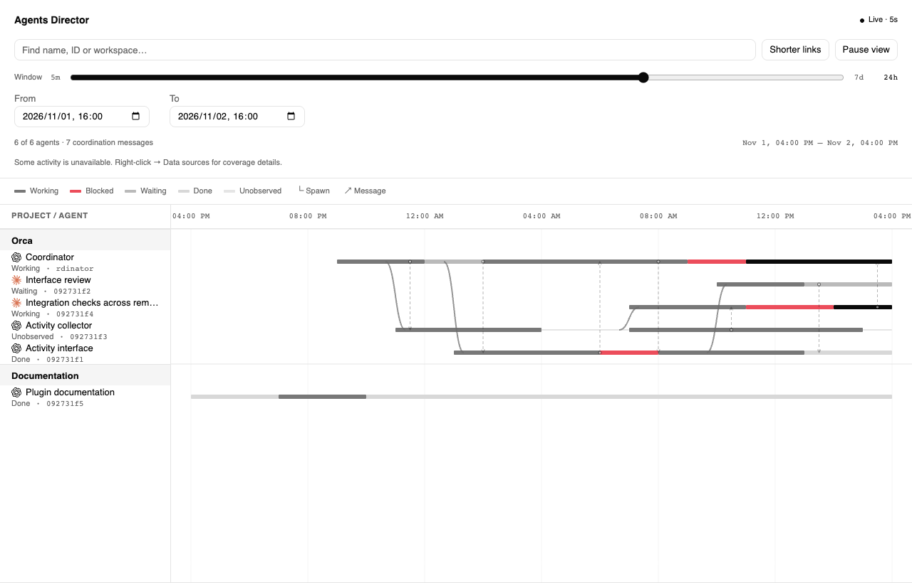
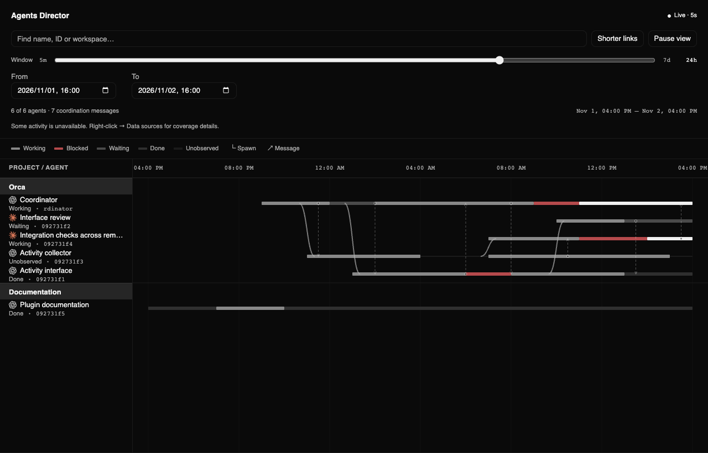

# Agents Director

See what your agents are doing across projects in one Orca timeline. Spot unexpected
orchestration behavior, check whether agents are coordinating as expected, and focus on
those active in the time window you care about—with less attention spent switching
between conversations and terminals.



<details>
<summary>Dark mode</summary>



</details>

_Screenshots use synthetic data._

## Features

- **Agent overview:** named lanes grouped by project show observed states over the last 7 days.
- **Orchestration visibility:** spawn links and Orca coordination messages help you follow
  handoffs and spot unexpected relationships or missing synchronization.
- **Focus by time:** zoom, pan or select a time range to show agents active in that window.
  Pause the view to inspect a moment without stopping collection.
- **Readable connections:** sort by recent activity or toggle **Shorter links** to bring
  connected agents closer together, with smooth transitions.
- **Quick navigation:** click a state or message for details; Command-click an agent on macOS
  or Ctrl-click on Windows/Linux to jump to its terminal. Right-click offers the same action.
- **Flexible layout:** open a full editor tab or sidebar panel. Time-window duration and
  lane-order preferences persist between sessions.

Missing observations stay unknown. Message records show communication, not proof that an
agent understood or acted on it.

## Install

Requires **Orca ≥1.4.246 / plugin Host API 1.2** on desktop.
Open **Settings → Plugins → Add plugin → From a Git URL…** and enter:

```text
https://github.com/Kyino-Pan/orca-agent-activity#main
```

Approve the access request, then open **tab-bar + → Agents Director** or the **Agents Director**
sidebar panel. No build step is needed.

Free, MIT-licensed community plugin. Reads local agent logs and keeps a private history
cache; no analytics or telemetry. Not an official Orca product.

See the [reference](docs/reference.md) for controls, data sources, coverage limits,
remote profiles, browser preview and development instructions.
