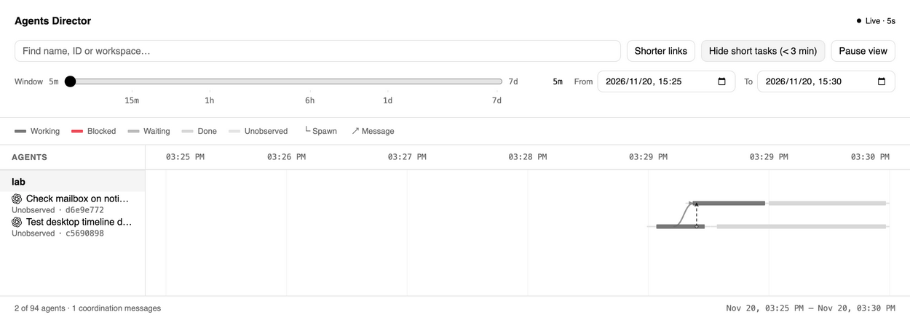

# Agents Director reference

## Requirements and installation

Orca **>=1.4.260**, plugin Host API **1.10**, desktop. The version floor covers
`agent.listSessions`, the expanded `agent.resume`, public session identities,
workspace/project listing and terminal focus. Workspace-scoped `agents.list` requires
host API 1.10; detecting the older method by name alone is insufficient. See Orca's
[host API reference](https://github.com/stablyai/orca/blob/main/docs/reference/plugin-host-api.md).

Install `https://github.com/Kyino-Pan/agents-director#main` through
Settings → Plugins → Add plugin → From a Git URL. Open the Agents Director panel
or create an Agents Director editor from the tab-bar + menu. New permissions must
be approved in Orca before updating from 0.1.x.

The desktop panel and custom editor read the version from their packaged
`orca-plugin.json` and render their own translations. Version 1.4.260 documents
`orca.locale` and relative package resources. Its command and contribution titles
are literal manifest strings. The host’s language-pack contribution translates
Orca’s own interface. The plugin keeps its brand and manifest fields in their
declared form. The picker changes only Agents Director. Unknown host diagnostics,
session names, project names and message contents retain their original text.
[Desktop frame API and package resources](https://github.com/stablyai/orca/blob/3330a89fa30edfd154901546f368ab4d6329962c/docs/reference/plugin-authoring.md#files-and-assets)
· [Manifest reference](https://github.com/stablyai/orca/blob/3330a89fa30edfd154901546f368ab4d6329962c/skill-guides/orca-plugin-authoring/references/manifest.md)
· [Directory maintainers’ API requirements](https://github.com/Kyino-Pan/agents-director/issues/11)

## Timeline and controls

Lanes use public session titles, harness labels and workspace/project membership.
Task titles from `agents.list` provide fallback names. A terminal with no public
session identity can show observed states, but cannot be resumed by this plugin.

- Search by name, identity or workspace.
- Select a lane or state for details; copy its identity from the detail panel.
  The lane label uses state intervals in the selected window. “Last: Done” gives
  the last observed state when coverage ends before the right edge. If later intervals
  in the window were omitted, “Last retained: Done” identifies the last available
  observation. “Messages only” means the window contains communication but no
  available execution interval.
  Select an individual gap to see its coverage.
- Use the window slider, duration presets, From/To controls, pan or modified wheel
  to inspect a period from five minutes to seven days.
  Horizontal gestures reproject retained observations at up to 60 frames per
  second while viewport requests are coalesced. Unloaded intervals stay empty
  until their matching snapshot arrives; missing activity is never synthesized.
- Pause view freezes inspection while collection continues.
- Hide short tasks filters only reliably finished executions below three minutes.
  Incomplete history remains visible. Session summaries alone never prove a short task.
- **Group related lanes** places lanes with spawn or message connections closer together.
  Switch it off to restore recent-activity order.
- Select **Language** beside the live status to choose Chinese, Japanese, Korean,
  English, French or German. **Follow Orca** uses the public frame locale and then the
  browser’s language preferences if Orca has no valid locale. Regional tags preserve local
  number and date formatting. An unsupported Orca language falls back to English. Panel and editor share the same language preference.
- Hover over a project or terminal name to show its pin button. A filled pin stays visible. Tab to the pin and press Enter
  or Space to toggle it. Pinned projects lead the list. Pinned terminals lead their own
  project and remain searchable in idle windows. An idle pinned project keeps just its
  heading. Unpinning restores the usual window and short-task filters.
- Only a saved pin on an individual matching terminal exempts it from **Hide short
  tasks**. The lane details identify short executions shown this way. Pins reserve
  places within the existing 160-lane snapshot limit. The recorder’s retention and
  identity limits still apply. Project pins use host and project IDs. Terminal pins
  use host, workspace, provider and session identity, with the exact recorded lane
  ID as a fallback when there is no public session ID.
- Right-click → Data sources shows collection errors, truncation and coverage.
- Layout preferences use the plugin's own storage.

Command-click on macOS or Ctrl-click elsewhere opens the selected session. The
context menu offers the same **Open or resume terminal** action. Both controls
explain which public identity is missing when the session cannot be opened. Navigation first
rechecks workspace membership and current agent ownership through public APIs.
It focuses an exact matching terminal; otherwise it verifies the original session
in that workspace's public history and calls `agent.resume`, then `terminal.focus`.
Ambiguous ownership, missing identities/workspaces, unsupported providers and host
denials are reported. There is no shell or internal-runtime fallback. Restoring a
Chat-specific tab is not part of this API: saved sessions resume through Orca's
terminal workflow. The host controls provider, account, execution host and launch
policy. A cancelled focus reports failure even if a resume already started.

A live session with no terminal address, or a terminal address claimed by conflicting
public identities, is not resumed or focused. Session IDs match in full with the
provider and original workspace; titles and the displayed eight-character suffix
are never navigation addresses. Before focusing, `terminal.list` must confirm that
the returned terminal still belongs to the original workspace. A stale resume
receipt naming an unlisted terminal is reported without retrying or focusing it.

If several local workspaces share the exact same public folder path, Orca's history
can attribute a session to another workspace. A previously observed terminal proves
the original route: the plugin can verify the full provider/session identity in
global public history and resume in that original workspace after checking every
local folder alias for an existing owner. A live owner in another alias, duplicate
history identities, different paths or hosts, a changed workspace host, missing
origin evidence, or an incomplete workspace inventory prevents this recovery.
History-only lanes do not acquire an origin from a matching title or path. Host
resume denials remain failures; check Orca's Session History for available options.
An agent inventory at the public API's 50-row cap cannot prove unique ownership or
that a session is absent, so navigation reports incomplete coverage.

## Data and coverage

The worker calls only:

| Method                                            | Purpose                                                   |
| ------------------------------------------------- | --------------------------------------------------------- |
| `workspace.list({ includeStatus: true })`         | Discover public workspace ids and names                   |
| `project.list({})`                                | Resolve project names on the matching host                |
| `agents.list({ workspaceId })`                    | Observe each workspace's current terminal agents          |
| `agent.listSessions({ limit: 200 })`              | Read newest session summaries every 30 seconds            |
| `agent.listSessions({ workspaceId, limit: 200 })` | Verify launch creation time or a saved navigation session |
| `agent.resume({ workspaceId, agent, sessionId })` | Resume after a navigation action                          |
| `terminal.list({ workspaceId })`                  | Confirm the terminal's original workspace before focus    |
| `terminal.focus({ terminalId })`                  | Focus a freshly matched or resumed terminal               |

Current inventories refresh every five seconds, at most four workspace requests
at a time. `agent.status.changed` updates identities already known from public
results. `workspaceListId` is preferred over the older event's internal address;
unknown identities wait for the next public inventory. An event arriving during an
older inventory response wins for that terminal. Event state is not extended by
merely reading a panel snapshot.

An unpinned lane qualifies for the window through working, blocked or waiting
observations (including observed activity omitted from the plot), a plotted message endpoint or a spawn. A window containing only Done or Unobserved stays hidden, even when the completion is known. The recorder identifies a completion at the first Done
observation after a different observed execution state on that lane. If a gap separates
these observations, both bounds of that change must fit in the view to establish a
completion there. A new sample
of an already completed terminal, including after a recorder restart, starts a
fresh coverage interval without creating a new completion. A first-ever Done
observation lacks that transition evidence. Individual observations can qualify at
either window boundary even when their interval has zero width. This window rule is
independent of the full-task execution measurement. Both operate on the snapshot
and preserve the recorded points.

Every state interval is bounded by observations. Missing terminals, failed reads,
worker downtime and poll gaps over 15 seconds stop continuity; they never imply
continued work or completion. Session `createdAt`, `updatedAt` and `running` are
metadata, not execution intervals. Before public collection, history is unknown.
The public session list omits subagent transcripts and Antigravity IDE conversations.
The plugin cannot restore historical states it never observed. Remote coverage is
limited to what the connected Orca host exposes through these APIs; there are no
custom profile directories, copied databases or direct remote-file reads.

Session history is bounded to the newest 200 sessions across workspaces, and the
host may truncate workspace/project lists. Source details report these limits.
The snapshot includes up to 160 lanes, 4,000 segments across those lanes and
600 messages. Short-task eligibility is decided before the lane budget. Pins
reserve places first. The newest 600 eligible verified mail observations then
reserve their session endpoints, newest plotted time first, with message ID as
the tie-break. Both endpoints of a directed message must fit together; an unfit
pair is skipped without turning it into a receiver-only message. A real
receiver-only observation needs one place. In-progress send attempts do not
reserve lanes. After pins, verified mail and in-window spawn pairs, windowed requests
fill remaining places with lanes that have active observations in that window,
before inactive session summaries. The worker uses the panel's existing observation
evidence, including bounded intervals and instantaneous active observations; work
outside the requested window does not qualify. Unreserved attempts keep the
existing fallback selection. Each tier uses label order, with
session identity breaking equal-label ties. If active lanes alone exceed the
remaining budget, that same order decides which fit. Unused places can still carry
other session summaries for inspection. Requests without a window retain the
original seven-day selection. Selected rows retain the usual pinned/label display order.
If pins alone exceed 160, that same stable order decides which fit. A pin can
still retain a filtered short task; mail alone cannot override that policy.

Lane selection does not delete recorder messages or change their endpoints and
times. Unpinning changes a preference, not the stored messages. A terminal that
still qualifies through retained mail keeps its connections; a short task hidden
again by the filter can lose its own connections. Unrelated retained endpoints
remain connected. A message already saved with its endpoints can reappear after an upgrade
or reload while its recorder evidence remains within retention/cache limits.
Messages that never had an accepted receipt or a verified check cannot be
reconstructed from this change. The plugin does not query CLI inbox history,
infer a sender from text, or turn provider-internal collaboration into Orca mail.

Each frame requests its visible duration and either a live end or an anchored
pan/pause end. The worker applies that window before allocating segment places,
retaining exact crossing intervals, short-gap join evidence at the edges, the
previous observed state and plotted mail endpoints (including later retrieval).
Older intervals outside that view do not compete with its working bars. Each
frame has its own request; changing the window discards older replies and keeps
the previous complete plot until the new one arrives. Pausing anchors the time
window while window changes can still request its recorded history. Callers that
omit the window keep the original seven-day snapshot contract.

When the requested evidence exceeds the interval reply budget, the snapshot first reserves the
existing intervals covering both endpoints at the plotted message time, the
receiver at retrieval, and each lane's latest interval. Sparse lanes keep
their full history when it fits. Dense lanes share the budget and fill their
remaining places with recent intervals. For omitted segments, the worker retains the
exact bounds of observed working, blocked or waiting time. Only windows overlapping
those bounds qualify through omitted activity. The frame retrieves the affected
rows’ omission metadata in a separate reply bound to that snapshot. Done intervals and gaps can still
carry a clipping notice when another event or a pin keeps the lane visible. “History limited” appears when such
a window contains no retained state interval. The recorder bounds
state points at 8,196 and messages at 5,000. The seven-day time bound and storage
byte limits still apply, so these are record limits rather than a guaranteed
duration of execution history. Continuous observations of the same terminal state
already extend one point's end time; display-only gaps are generated for snapshots
and are not stored as points.

The worker also applies conservative size and structure policies to replies.
Ordinary replies still use up to 4,000 intervals. Long fields or many instantaneous
observations can leave fewer interval places: the worker rebuilds the same snapshot
with the existing endpoint/latest reservations and fair shares. When reducing fill,
it selects bounded Working, Blocked and Waiting intervals before optional Done
intervals or gaps, newest first within each tier. Exact omissions use the same
notices. Lane membership, pins, message identities,
message details, spawn metadata and instantaneous observations are preserved.
Older callers retain their inline omission ranges. The policy uses UTF-8 string
weights and structural allowances with a target 4 KiB below the public 1 MiB
limit, plus an independent 8,192 object/array guard. The latter counts reply
containers, separately from the 8,196 recorded state points. Main and paired omission
replies are both checked before choosing fill. These are application policies, not
the host's acceptance algorithm or a JSON export-size test. If protected evidence alone exceeds that
estimate, the worker submits it intact for the public bridge to accept or reject;
it does not delete messages or endpoints to force a fit. A bridge rejection leaves
the previous complete plot visible; a narrower window can reduce the reply.
This affects replies only; it does not
delete recorder data or recover already expired observations.

After pins and verified mail reserve lanes, in-window verified spawns reserve
both eligible endpoints together within the remaining 160 places. An endpoint
with no other activity can still show its real spawn. An unfit pair is skipped;
no replacement parent or child is invented. The short-task policy still applies.

**Other coverage limits.** There is no public coordination history feed. Conversation
bodies, recent user inputs, process memory and private execution metadata are unavailable. The recent-input section explains that
conversation text is unavailable. No terminal screen scraping is used to infer it.
No CLI subprocess, internal RPC, runtime token, database or provider transcript is
read by the worker.

## Coordination

Orca 1.4.265 was tested with local Codex 0.171.0 on macOS. A disposable Orca
profile hosted the plugin and test terminals. One Codex session ran
`orca agent launch --agent codex --surface terminal --prompt ... --json`, then
`orca orchestration send --to term_… --subject ... --body ... --json`. The receiver
ran the ordinary `orca orchestration check --terminal term_…`. The public tool
hooks reported `agent: codex`, `tool: Bash`, `terminalId`, `callId`, an
`input.command` string and, after the call, a string `output`. The JSON send
receipt contained `ok: true` and `result.messageId`. The receiver's default text
header contained the same ID. Neither `terminal.send` nor `agent.prompt.before`
was needed to establish these relationships.

The screenshot shows two real local Codex terminals on an isolated Orca desktop.
The lower session launched the upper session and then sent it a test message.
The solid curve marks the launch. The dotted vertical line with an open arrowhead
marks the message retrieved by the upper session. The capture used the normal
Agents Director custom editor at five-minute zoom and `orca plugin shot`.



- A dotted send attempt can appear while a directly addressed call is in progress.
  It expires in memory. A successful single-message receipt records acceptance.
  An ordinary mailbox check reporting that ID confirms retrieval at the receiver.
  The arrow stays at the send receipt time. Message details show both lane states
  at that time and the receiver's state at retrieval. A larger open circle marks
  an endpoint without an observed state. Each horizontal bar shows its measured
  duration, even below one pixel. Zoom in to inspect a short interval or select
  its hit target for the exact duration. Grouped arrows use the first message's
  position. Select a group member to inspect its own times and observations.
  A diamond denotes a confirmed mailbox input when the sender is unobserved.
- Terminal launch receipts from `agent launch --json`, `worktree create --agent --json`
  and a ready `orchestration worker-start` can supply a child handle. Worker starts
  support JSON and the default concise receipt with explicit `mode=terminal`.
  A solid curve requires the first observed public session identity and a public
  session creation time at or after launch began. Worker starts accept
  `--spec`, `--spec-file` and `--task`,
  including a task title and a base branch for a new worktree. An attached
  existing terminal (`--terminal`) can establish a dispatch address.
  It cannot create a parent relationship. `agent resume` is excluded.
  If the global session list lacks a proven launch's creation time, the collector
  asks that session's workspace history. At most four workspace reads start per
  inventory scan, and each pending workspace is retried at most once per 30 seconds
  within the existing two-minute evidence lifetime. A missing, denied or older
  creation time still cannot establish a parent. No private history is read.
- Sender and receiver identities come from the live terminal inventory and status
  changes. An observed ready dispatch can resolve `dispatch:…` to the same live
  terminal session. For a bot, run, implicit mailbox or unmapped dispatch, a matching
  send and receiver check ID can join the two observed terminals. Names, task titles
  and time proximity never supply an endpoint. A send into native chat or bot
  Home Chat without a matching public terminal receipt leaves the recipient
  unresolved. Alias and attached-dispatch cases have regression coverage.
- A direct `ask --question ... --json` with a pending message ID or a successful
  `reply --id ... --body/--body-file ...` supplies the sender and acceptance time.
  A reply uses its newly returned ID. The question can be missing. Only a consuming
  check for the returned ID supplies the recipient and retrieval time. Until then
  these receipts stay in memory. A run-scoped check requires an explicit terminal
  matching the hook's own terminal.
- Parsing accepts a direct `orca`, `"$ORCA_CLI_BIN_DIR/orca"`,
  `"$ORCA_CLI_COMMAND"` or `"${ORCA_CLI_COMMAND:-orca}"` command, plain send/reply
  receipts or JSON, and concise worker-start receipts. The variable spellings are
  recognized literally; the collector never reads or expands their values. A
  single final ` 2>&1` is allowed to combine the same command's output. Other
  redirects, command substitutions, wrappers and additional commands are rejected.
  Explicit `--environment local` and
  `--environment=local` follow the CLI's global-flag positions before, within or
  after the command path. Other environments, repeated selectors and competing
  remote flags are rejected; no saved alias is resolved. Message IDs may contain
  nonempty underscore-separated segments, with the existing 128-character suffix
  limit and ASCII identity constraints.
- JSON checks recognize up to 200 IDs. Text `check --full` can establish a batch
  in the public CLI's tagged format: each message has a header and `[subject]`,
  optional `[body]`/`[payload]` fields, with every content line indented by two
  spaces. Public reply/follow-up actions and optional item hints have explicit
  footer grammars, including active workers, quoted bot/server names, every item
  status and completion criteria. These are advisory text, never endpoints.
  Header-looking content stays inside its field. Duplicate IDs, legacy/replay
  prefixes and over-budget text batches are rejected. Malformed fields or an
  unproved action boundary stop scanning and keep earlier proved records. After
  a proved action boundary, unfamiliar metadata quarantines that record while
  later complete records can still be retained. Arbitrary brackets do not prove
  a boundary. The final CLI advice is never scanned for more messages.
  Ordinary concise text and older raw-body formats have no safe
  framing contract for later headers; they retain only the first header. Use
  `--json` for complete batches across CLI versions and action/footer formats.
  Read-only audit rows and explicitly replayed JSON results do not prove receipt.
  Receipt header/body claims never provide the sender identity.
- Compound shells, other redirects, substitutions, failed calls,
  cross-server sends, replay commands, ambiguous ownership and group sends are
  excluded. Both tool phases must have
  matching call and terminal IDs. An unresolved receipt stays in memory for up
  to two minutes, with 512 entries per pending collection. A direct accepted
  arrow can be confirmed later while retained in the seven-day cache.
- If two sessions report successful sends with the same message ID, the recorder
  removes the sender and keeps a conflict flag on that ID within the message
  cache's existing retention and size limits. A verified retrieval keeps its
  receiver and check time. The panel shows the receiver-only diamond after that
  check, including after a cache reload.
- A tool hook is available on supported local terminal agents while the plugin
  runs. A command invoked in a plain shell, a native chat or on SSH/WSL does not
  give the plugin the same hook pair. For those surfaces, broader coverage needs
  a public event that carries a message ID, both stable session identities and
  the acceptance or delivery stage.

### Terminal provider contracts

The collector accepts `Bash`, `Shell` and `exec_command` tool hooks, plus Devin's
`exec`. Devin's documented `PostToolUse` response is an object with `success`,
string `output` and `error`; Orca passes it through to `agent.tool.after`. An exec
receipt requires `success: true`, no nonempty error, and a successful recognized
CLI receipt inside `output`. A failed tool's receipt-looking text is rejected.
Missing call IDs, unresolved terminal ownership and mismatched providers remain
unobserved. A session or turn ID never substitutes for a tool call ID.

Devin's [hook reference](https://docs.devin.ai/cli/extensibility/hooks/lifecycle-hooks#posttooluse)
and the installed Orca 1.4.274 field projection were checked with controlled raw
payload replay. Official `orca/testing` worker hooks and requests exercised
Devin → Claude, Claude → Devin and Codex → Devin. Node fixtures exercise all nine
source/target provider pairs; browser fixtures follow the two Claude/Devin
directions through to solid spawn and dashed retrieved-message paths. These are
contract and mock-host checks, not a live Devin or Claude terminal run or a
paid-model test. The earlier real Codex measurements below retain their own scope.

Native Chat and provider-internal subagents still lack the public terminal
identities and hook pairs this collector requires. Creating a workspace without
an agent does not prove a spawn. Attaching or resuming an existing session does
not create a new parent link. History in another workspace does not supply a
creation bound until public ownership can establish an unambiguous match.

### Local terminal reproduction

On Orca 1.4.265 and Codex 0.171.0, a disposable desktop loaded the baseline
(`df03861`) and candidate collectors together. Two real terminal sessions
exercised two dispatches in the same Run. To reproduce in a test profile, use
the coordinator and worker's own terminal tools for each exchange.

1. From the coordinator terminal run `"$ORCA_CLI_BIN_DIR/orca" orchestration worker-start --spec-file <fixture> --task-title first --worktree new-child --name <name> --base-branch main --agent codex --json`.
2. Have the worker ask one question using `orca orchestration ask --question <text> --json`.
   Consume it in the coordinator with the supplied `check --run <run> --terminal <own-terminal>`.
   Reply using `reply --id <question-id> --body-file <fixture> --json`.
   Have the worker consume the reply and send its normal `worker_done`. Consume the completion.
3. Create another task with `task-create --spec-file <fixture> --task-title second --json`.
   Attach it with `worker-start --task <id> --terminal <same-worker-terminal> --json`.
   Repeat the exchange using plain `reply --id <question-id> --body <text>`.
4. Compare `activity.snapshot` with `hideShortTasks: false` on both collectors.
   Count the unique IDs from the Run and two Dispatch inboxes. A message is
   missing when its ID has no snapshot row. Count parent links separately.

| Observed in the same two dispatches   | Baseline | Candidate |
| ------------------------------------- | -------: | --------: |
| Parent links for one fresh session    |        0 |         1 |
| Additional parent links on attachment |        0 |         0 |
| Messages with both session endpoints  |        0 |         6 |
| Receiver-only messages                |        2 |         0 |
| Missing messages out of six           |        4 |         0 |

Both questions and both completions went from worker to coordinator. Both replies
went in the reverse direction. Each reply had a new ID that matched the worker's
check. The observed acceptance-to-retrieval intervals spanned 5.0–7.4 seconds.
The CLI fenced a run-scoped consuming check from a different bound terminal and
from an unbound terminal. The bound caller then retrieved the waiting message.
The final parser also rejects an explicit non-terminal launch mode. Replaying
the two captured terminal-mode receipts and six message IDs with the final
guards produced the same endpoints and stages. A separate native repeat reached
`start_unknown` before any exchange and produced no parent link. It contributes
no successful dispatches or messages to the table.

In this macOS terminal profile `"$ORCA_CLI_COMMAND" --version` failed, while
`"$ORCA_CLI_BIN_DIR/orca"` ran the bundled CLI. A nested `sh -c` send returned
a real message ID and the outer shell hook supplied no direct send evidence.
`worker-start --item` was refused in an ordinary terminal. The option belongs
to a bot's own chat. These tests measured local terminal sessions only. The
availability of terminal hooks for a different client, or the cause of a
receiver-only row in an existing installation, cannot be inferred from these counts.

### Working intervals

Working bars use bamboo green in both host themes.
The timeline joins working observations on the same lane when the gap from one
end to the next start is strictly below 30,000 ms. Chains can include short
waiting, blocked and unknown intervals. A completion ends a chain, including
a zero-duration completion. Each interval keeps its observed state and source in
the detail view. A leading or trailing gap stays unknown. Display duration is
considered before hiding completed tasks shorter than three minutes.

## Cache and upgrade

Own storage keeps compressed observations under `activity-public-v1`, with an
alternating chunk generation and an atomic head update. It saves about every
15 seconds and on orderly shutdown; offline intervals stay unknown after restore.
The encoded budget is 1.8 MiB; decompression is bounded to 32 MiB. Storage failures
appear under Data sources. An over-budget save keeps the previous generation.

Before staging a generation the worker lists its own keys and deletes obsolete
0.1.x recorder heads/chunks by name, plus public chunks outside the committed
head. It never reads or imports private-source history. Two full encoded generations
(1,843,200 bytes each) and their pretty-printed JSON keys/values together occupy
under 3.53 MiB of the host's 5 MiB quota. If unrelated keys occupy the remaining
space, the host can refuse the save. The next attempt uses the stored head to
recover even when the previous worker stopped mid-write.

Storage checks use only the public key list and head.
After observing existing keys, the recorder defers writes if that storage disappears
or the head and key list disagree. Live collection continues until the reads recover.
On a new installation, two empty observations on separate refreshes start normal
recording, usually after five seconds. Until then, observations are in memory.
Orca 1.4.260 can report the same empty list
and absent head for a persistent filesystem read error on cold start. Its public API
provides no first-install or storage-health signal. If an error such as `ESTALE`
persists through the first snapshot write, the host can replace the unreadable file.
[Orca 1.4.260 KV implementation](https://github.com/stablyai/orca/blob/3330a89fa30edfd154901546f368ab4d6329962c/src/main/plugins/storage/plugin-storage-store.ts#L36-L97)

Existing window and
order preferences remain in the same plugin-owned storage. `dataDirectories` was
removed and no longer selects any filesystem roots. Versions before 0.2.0, legacy
screenshots and cover artwork describe the earlier implementation.

## Development and validation

Node **>=22.13** is sufficient. In this checkout:

```sh
npm ci
npm run lint
npm run format:check
npm test
orca plugin validate . --json
orca plugin check . --json
ORCA_BACKGROUND_LAUNCH=1 orca plugin test . --json
orca plugin inspect /path/to/clean-package --json
```

Run `plugin inspect` on a clean package containing only versioned files: a development
checkout with `node_modules` can fail its symlink check. Validation and tests above
run in the development checkout.

No runtime bundle or build step is needed. The icon-generation script uses esbuild
and React only as development dependencies; see NOTICE.md.

`npm run preview` starts a loopback browser preview with **synthetic data only**.
It reads the plugin's own UI assets, not Orca data. It cannot navigate or resume
real agents. Old `--data-dir` arguments are no longer supported.

Node tests use a strict fake public host, covering identity changes, missing and
failed observations, event/inventory races, history truncation, ownership checks,
resume/focus errors and storage restore. Resume/focus calls are mocked. Browser
tests cover rendering and controls at desktop and narrow widths. Plugin validation
and checks do not prove live provider resume or all native platforms. No checks
should start or resume a real conversation without a deliberate navigation action.

The `validate-plugin` CI job runs Orca's official `validate:plugin` against a clean
plugin checkout using the pinned v1.4.260 source revision and Node 24. It follows the
official catalog CI's JavaScript-only dependency setup (`--ignore-scripts`), without
building or launching Electron. The main test job still exercises Node 22. Update
the validator revision deliberately when adopting newer host APIs.
